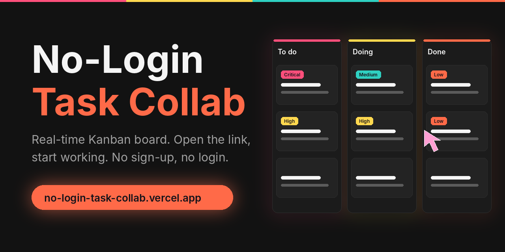

# No-Login Task Collab



A real-time Kanban board your whole team can use instantly: open the link and start working. No sign-up, no login, no setup.

**Live demo:** https://no-login-task-collab.vercel.app/

## Features

- **Real-time collaboration:** everyone on the board sees changes the moment they happen, powered by [Liveblocks](https://liveblocks.io).
- **Live cursors:** see where your teammates are pointing.
- **Drag and drop:** reorder lists and move cards between lists ([dnd-kit](https://dndkit.com)).
- **Categories:** group lists into categories, and move lists or cards between them.
- **Card details:** title, description, priority (None, Low, Medium, High, Critical) and a done toggle.
- **Images on cards:** upload a picture or paste one straight from your clipboard (hosted on [Cloudinary](https://cloudinary.com)).
- **Undo and redo:** `Ctrl+Z` and `Ctrl+Shift+Z`, shared with the live board.
- **Light and dark mode.**

The default board has these lists: Content, Wireframe, Design, Development, Responsiveness, Animation, Testing, Deployment and A1 Developer. You can rename, add and remove lists.

## Tech stack

React 18, Vite, Liveblocks (`@liveblocks/client`, `@liveblocks/react`), dnd-kit, Cloudinary (unsigned uploads).

## Run it locally

Requires Node.js 18 or newer.

```bash
git clone https://github.com/Kaosar3662/No-login-task-collab.git
cd No-login-task-collab
npm install
npm run dev
```

Then open the URL Vite prints (usually http://localhost:5173).

Other scripts: `npm run build` (production build into `dist/`) and `npm run preview` (serve that build locally).

## Use your own Liveblocks and Cloudinary

The project ships with demo credentials, so a fork shares the same board and upload account as the live demo. For your own private board:

1. **Liveblocks:** create a project at [liveblocks.io](https://liveblocks.io), then replace the public key in `src/liveblocks.config.js`. Change the room `id` in `src/App.jsx` to start with a fresh board.
2. **Cloudinary:** create an account, add an **unsigned** upload preset, then update `CLOUD` (cloud name) and `PRESET` in `src/cloudinary.js`.

## Good to know

There is no login, so **anyone with the link can view and edit the board**. That is the point of the project, but don't put sensitive information on a shared board.

## Project structure

```
src/
  App.jsx                 Room setup and theme
  liveblocks.config.js    Liveblocks client and hooks
  cloudinary.js           Image upload helper
  constants.js            Default lists, priorities, helpers
  theme.js                Light and dark themes
  components/
    Board.jsx             Board, categories, live cursors, drag and drop
    Column.jsx            A list
    Card.jsx              A card
    AddCardForm.jsx, EditCardForm.jsx, AddListForm.jsx
    CategoryMenu.jsx, CategoryPickerPopover.jsx, MoveCardModal.jsx
    ImageUpload.jsx, PasteImageOverlay.jsx
```

## Deploy

It is a static Vite app, so it deploys to Vercel, Netlify or any static host. Build command: `npm run build`, output directory: `dist`.
